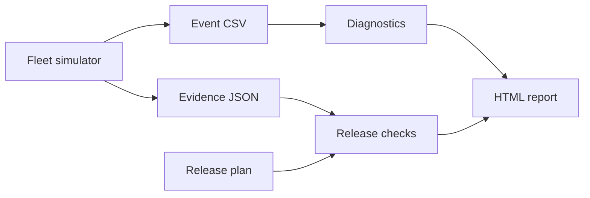

# Robotics Fleet Ops · FMS Diagnostics

A Python CLI for warehouse robotics support. It triages faults from fleet logs, validates staging evidence against a release plan, and runs an offline simulation that collects its own evidence and generates charts.

**See the result** in the [example regression report](docs/example-regression-report.html). Download the HTML from GitHub and open it in your browser to view the charts offline.

| Demo run | Release checks | CLI exit |
| --- | --- | --- |
| Baseline | 10 passed | `0` |
| Regression | 7 passed, 3 failed | `1` |

The example recreates a warehouse robotics support workflow. AMR-205 logged three scanner faults across three jobs, and a peer robot reported the same fault in the same zone. The release checker detected a stale firmware version, a job assigned to an offline robot, and missing workstation telemetry.

## Run the demo

Clone the repository or download its ZIP, then open a terminal at the project root. Use Python 3.10 or newer. The CLI uses only the Python standard library.

### Run the end-to-end simulation

```sh
mkdir -p reports
python fleet_ops.py simulate --scenario baseline --output reports/baseline
python fleet_ops.py simulate --scenario regression --output reports/regression
```

Use a fresh output directory for each run. The simulator creates synthetic events and executes staged firmware, registration, assignment, and onboarding operations. It collects observations from the simulated device and job state, timestamps each observation, and validates the resulting evidence against the checked-in release plan. The release plan and the simulator's observations are separate inputs to validation.

Both scenarios generate three target-robot scanner faults and one matching peer fault. The site summary counts **five total faults** across two zones during the one-hour window. The baseline passes all ten checks and exits `0`. The regression passes seven checks, records three failures, saves all reports, and exits `1`.

| Output | Contents |
| --- | --- |
| `report.html` | Offline incident timeline, fault chart by zone, validation chart by area, and per-case differences |
| `events.csv` | Full event stream emitted by the simulator |
| `evidence.json` | Observations, source, and simulated observation timestamps |
| `incident.csv`, `diagnostics.json` | Target-robot timeline and diagnostics, with peer events included in the JSON |
| `fleet-window.json` | Site-level counts by zone, device, and fault code |
| `validation.json` | Release check results and field differences |

The regression scenario models a firmware update that leaves the old version installed, an assignment to an offline robot, and a workstation that stops reporting telemetry. Open either run's `report.html` in a browser to review the results.

### Generate an incident report

```sh
python fleet_ops.py diagnose --events demo/events.csv --device AMR-205 --site RI-01 --start 2026-11-25T14:00:00Z --end 2026-11-25T15:00:00Z --csv incident.csv
```

The command prints a JSON report and creates a CSV containing the selected robot's timeline. It reports three instances of `FRONT_SCANNER_FIELD_OCCUPIED` on three separate jobs. It also reports one matching fault on AMR-207 in the same zone. That peer event gives the support team a reason to compare zone conditions and job context during triage. The export itself establishes only that the two devices reported the same code in the same zone and time window.

The start time is inclusive and the end time is exclusive. Use ISO 8601 timestamps with an offset, such as `Z` or `-06:00`. The report counts `ERROR` and `CRITICAL` events as faults. Peer matches use the same site, zone, code, and selected time window. For subsequent runs, choose a fresh CSV path because the command protects existing files.

### Validate a staged release

```sh
python fleet_ops.py validate --plan demo/release-plan.json --evidence demo/release-pass.json
python fleet_ops.py validate --plan demo/release-plan.json --evidence demo/release-regression.json
```

The first run reports **10 passes**. The second reports **7 passes and 3 failures**. Its failures show an unexpected firmware version, a job assigned to an offline robot, and missing workstation telemetry.

| Area | Demo cases |
| --- | --- |
| Firmware | Version, reconnection after restart, and smoke-test result |
| Registration | Accepted sensor registration, rejected duplicate ID, and rejected missing site |
| Job assignment | Assign when eligible, queue when offline, and reassign after interruption |
| Onboarding | Monitoring visibility, telemetry, and an end-to-end smoke test for a robot, sensor, and workstation |

Exit codes work in shell scripts and release pipelines.

| Code | Meaning |
| --- | --- |
| `0` | Diagnostics completed or all validation cases passed |
| `1` | At least one validation case failed |
| `2` | Invalid arguments or input, or a file could not be opened |

## Use your own exports

1. Map exported events to the CSV header in `demo/events.csv`. All fields except `job_id` and `message` need a value. Use consistent site, zone, severity, and fault codes across devices.
2. Copy `demo/release-plan.json` and fill in expected results using your staging acceptance criteria. Each case needs a unique `id`, a supported `kind`, and all expected fields for that kind.
3. Run the staging scenarios using your fleet tools, then record the actual results in a separate JSON file following `demo/release-pass.json`. Use JSON booleans for telemetry and connectivity and `null` for an unassigned device or omitted registration site. The CLI compares observations by case ID and flags missing cases, fields, and unexpected observations.
4. Save the JSON validation output with the release ticket and attach the diagnostics CSV to the related incident. Use a shell redirect such as `> validation.json` to capture the report.

Live integration would require a device connector and staging access. This project runs locally with simulated fleet operations and supports existing CSV and JSON exports.

## Development

Run the CLI regression suite from the project root.

```sh
python -m unittest discover -s tests -v
```

GitHub Actions runs the same suite on Python 3.10, 3.12, and 3.14 for pushes and pull requests. Store generated reports under `reports/` and keep real fleet exports outside the repository. The tracked fixtures in `demo/` are synthetic.

## How the pipeline fits together



- [`fleet_simulator.py`](fleet_simulator.py) implements registration, firmware changes, dispatch, retries, and onboarding with deterministic synthetic data.
- [`fleet_ops.py`](fleet_ops.py) filters the event stream, compares the observed fields with the independent release plan, and exports machine-readable reports.
- [`fleet_report.py`](fleet_report.py) renders the incident timeline, fault distribution, and validation outcomes as standalone HTML.
- [`tests/test_cli.py`](tests/test_cli.py) exercises the CLI as a subprocess, including both simulation modes and input errors.

The repository uses the [MIT license](LICENSE).
