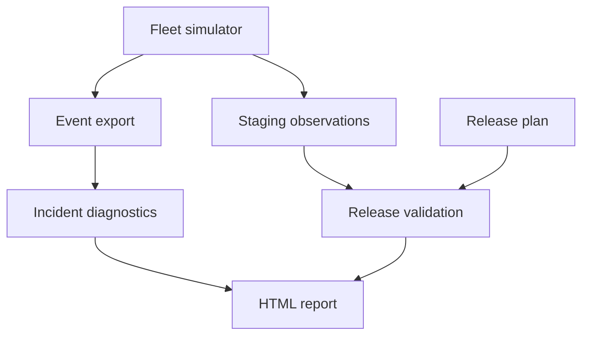

# Robotics Fleet Ops

Inspect warehouse robot faults, validate staged software changes, and generate a report that an operations team can use to investigate an incident or review a release. The CLI runs offline on **Python 3.10+** using the standard library. The demo uses synthetic fleet events and a stateful simulator.

[View the example regression report](docs/example-regression-report.html) · [GitHub Actions](https://github.com/fardeenshroff/robotics-fleet-ops/actions)

Download the example HTML from GitHub and open it in a browser to see the incident timeline, faults by zone, and expected versus observed results for each release check.

## Quick start

```bash
git clone https://github.com/fardeenshroff/robotics-fleet-ops.git
cd robotics-fleet-ops
python fleet_ops.py simulate --scenario baseline --output reports/baseline
python fleet_ops.py simulate --scenario regression --output reports/regression
```

Open `reports/regression/report.html` to review the results. Each run creates the output directory and its parents. Use a fresh run directory each time. The regression run writes all reports before returning exit code `1`.

| Scenario | Checks passed | Checks failed | Exit code |
| --- | ---: | ---: | ---: |
| Baseline | 10 | 0 | `0` |
| Regression | 7 | 3 | `1` |

## What the demo shows

**Incident triage.** AMR-205 reported `FRONT_SCANNER_FIELD_OCCUPIED` on three jobs in Zone C. AMR-207 reported the same code in that zone during the same hour. The site summary counted five faults across two zones. The peer event gives an operator a reason to check the shared zone alongside the target robot's job history.

**Release validation.** The simulator records timestamped observations from device and job state. The validator compares them with a [separate release plan](demo/release-plan.json) covering firmware, registration, assignment, and onboarding. The regression scenario exercises three failures.

| Check | Expected | Observed |
| --- | --- | --- |
| AMR-205 firmware | Version `2.8.1` after restart | Version `2.8.0` |
| JOB-902 with the eligible robot offline | Job queued with no robot assigned | Job assigned to AMR-205 |
| WS-22 onboarding | Telemetry received | Telemetry missing |

### Reproduce one failure

```bash
python fleet_ops.py simulate --inject firmware_not_applied --tz America/Chicago \
  --output reports/firmware-only
```

This run fails only the firmware check. Repeat `--inject` to combine faults. Options include `firmware_not_applied`, `dispatch_ignores_status`, and `workstation_no_telemetry`. Reports use UTC by default. Named zones use IANA time-zone data and follow daylight-saving changes. On systems without that data, install `tzdata` to use named zones.

## Warehouse disruption exercises

```bash
python fleet_ops.py exercise --output reports/fleet-exercises
```

Open the generated `index.html` for five research-backed scenarios. Each report includes the event timeline, a job timing chart, and the result of each checkpoint. Use `--scenario` to select a single exercise. The [scenario guide](docs/fleet-exercises.md) documents the operating references, assumptions, and replay commands.

## Commands and input formats

### Diagnose a fleet export

```bash
python fleet_ops.py diagnose --events demo/events.csv --device AMR-205 --site RI-01 \
  --start 2026-11-25T14:00:00Z --end 2026-11-25T15:00:00Z --csv reports/incident.csv
```

Use the column order in [the example CSV](demo/events.csv). Only `job_id` and `message` may be blank. The start time is inclusive, the end time is exclusive, and timestamps must include an offset. The CLI counts `ERROR` and `CRITICAL` events as faults. A peer match shares the target fault's site, zone, and code, and occurs within 15 minutes of a target fault by default. Set `--peer-window 5m` to tighten the correlation window. Exports are loaded into memory. The JSON includes those matches, and the CSV contains the target robot's timeline.

### Validate staging evidence

```bash
python fleet_ops.py validate --plan demo/release-plan.json --evidence demo/release-regression.json
```

Use the [release plan](demo/release-plan.json) for expected fields and the [passing evidence file](demo/release-pass.json) for the observation format. Cases match by unique ID and check type. Use JSON booleans for connectivity and telemetry, and `null` for an unassigned robot or omitted registration site. Missing cases, missing fields, unexpected observations, and mismatched values fail validation.

To reject old evidence, add `--max-age`. The following replays the synthetic baseline relative to a fixed demo time.

```bash
python fleet_ops.py validate --plan demo/release-plan.json --evidence reports/baseline/evidence.json \
  --max-age 10m --now 2026-11-25T15:05:00Z
```

When enabled, the check rejects stale evidence, missing or invalid `observed_at` values, and timestamps more than one minute ahead of the reference time. The reference defaults to the current time. Without `--max-age`, archived evidence can still be validated by field values alone.

| Exit code | Meaning |
| --- | --- |
| `0` | Diagnostics completed or all release checks passed |
| `1` | One or more release checks failed |
| `2` | Invalid arguments or input, or a file operation failed |

## Simulation outputs

| File | Use |
| --- | --- |
| `report.html` | Review the timeline, site fault distribution, and release differences offline |
| `events.csv` and `evidence.json` | Replay the raw event stream and timestamped staging observations |
| `incident.csv` and `diagnostics.json` | Export the target robot timeline and review matching peer events in the JSON |
| `fleet-window.json` | Review site fault counts by zone, device, and code |
| `validation.json` | Read per-case results and field differences in a release pipeline |

## Architecture



- [`fleet_simulator.py`](fleet_simulator.py) models firmware updates, registration, dispatch, interrupted jobs, and onboarding.
- [`fleet_ops.py`](fleet_ops.py) is the CLI entry point. It parses exports, checks evidence, and coordinates the simulation.
- [`fleet_report.py`](fleet_report.py) renders the charts and case details as standalone HTML.
- [`tests/test_cli.py`](tests/test_cli.py) exercises the CLI through its command-line entry point.

## Tests and license

```bash
python -m unittest discover -s tests -v
```

The [CI workflow](.github/workflows/ci.yml) runs the suite on Python 3.10, 3.12, and 3.14. The Python 3.12 job generates the simulation and disruption reports, adds the counts to the run summary, and uploads the reports in a `fleet-reports` artifact. Live integration would require a fleet adapter and access to a staging system. Keep real fleet exports outside the repository.

[MIT license](LICENSE)
