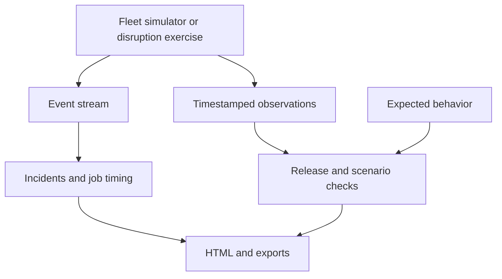

# Robotics Fleet Ops

Robotics Fleet Ops is an offline Python CLI for investigating warehouse robot faults, validating staged changes, and replaying fleet disruptions. It turns fleet events and timestamped observations into reports an operations team can use to trace jobs, review failure evidence, and compare recovery times.

**Python 3.10+ · Standard library · Synthetic demo data**

[Exercise results](docs/example-exercise-summary.md) · [Scenario references](docs/fleet-exercises.md) · [CLI reference](docs/cli.md) · [CI runs](https://github.com/fardeenshroff/robotics-fleet-ops/actions)

## Quick start

```bash
git clone https://github.com/fardeenshroff/robotics-fleet-ops.git
cd robotics-fleet-ops
python fleet_ops.py exercise --output reports/fleet-exercises
```

Open `reports/fleet-exercises/index.html` to compare the five scenarios and open each report. The suite also exports `summary.csv`, `summary.md`, and `summary.json`. Use a fresh output directory for each run. The CLI creates parent directories automatically.

### What the exercises demonstrate

The bundled suite completed **11 synthetic jobs** and passed **23 scenario checkpoints**. Queue time measures arrival to first dispatch. Reassignment time measures interruption to redispatch.

| Scenario | Behavior the report shows |
| --- | --- |
| `mid-job-offline` | After a disconnect before pickup, a spare robot took over **45 seconds** after interruption. An independent job completed during the hold. |
| `blocked-aisle` | A robot used the approved Zone D detour. Another job waited **75 seconds** for its only route to reopen. |
| `low-battery` | A job waited **420 seconds** while its eligible robot charged past the release threshold. A healthy robot kept working. |
| `stale-workstation` | An inbound job waited **45 seconds** for fresh station status. A separate transfer completed during that wait. |
| `dispatch-contention` | A second job waited **50 seconds** for the only eligible robot to finish its first job. |

To run just one case:

```bash
python fleet_ops.py exercise --scenario mid-job-offline --output reports/offline-only
```

## Incident and release validation demo

```bash
python fleet_ops.py simulate --scenario baseline --output reports/baseline
python fleet_ops.py simulate --scenario regression --output reports/regression
```

The baseline passes **10 of 10** checks and exits `0`. The regression run catches three seeded problems and exits `1` after writing its reports: outdated firmware, a job assigned to an offline robot, and missing workstation telemetry. Open `reports/regression/report.html` or download the [example HTML report](docs/example-regression-report.html) and open it in your browser.

In the incident portion of the demo, AMR-205 reports the same scanner fault on three jobs in Zone C. The CLI identifies a matching fault on AMR-207 within the configured time window. The report supplies a lead for checking the shared zone and the target robot’s job history.

## Which command to use

| Command | Use | Main outputs |
| --- | --- | --- |
| `exercise` | Replay one or all fleet disruptions and compare recovery behavior | HTML cases and suite index, CSV/JSON/Markdown summaries, checkpoint evidence |
| `simulate` | Run the original incident and release demo or inject an individual regression | HTML report, fleet counts, events, and evidence |
| `diagnose` | Investigate faults in a fleet CSV by site, device, time, and optionally a tighter peer window | JSON and an optional incident timeline CSV |
| `validate` | Compare staged observations with a release plan and optionally reject stale evidence | JSON field differences and a release exit code |

See the [CLI reference](docs/cli.md) for runnable input examples and output contracts.

## Architecture



- [`fleet_ops.py`](fleet_ops.py) handles CLI commands, event filtering, and evidence comparison.
- [`fleet_simulator.py`](fleet_simulator.py) models the baseline release and individual fault injections. [`fleet_exercises.py`](fleet_exercises.py) models disruption and recovery with explicit job states, robot eligibility, routes, and destination status.
- [`fleet_report.py`](fleet_report.py) renders HTML and suite summaries from the generated data.
- [`tests/`](tests/) covers CLI behavior, freshness, peer-window boundaries, time zones, exercise metrics, and evidence replay.

## Tests and scope

```bash
python -m unittest discover -s tests -v
```

The [CI workflow](.github/workflows/ci.yml) tests Python 3.10, 3.12, and 3.14. It also generates the demo reports for the GitHub Actions summary and the `fleet-reports` artifact.

The disruptions are based on public fleet documentation and research. The simulator uses synthetic jobs, fixed service times, and simplified route choices. Event exports are processed in memory. Live integration would require a fleet adapter and staging access.

[MIT license](LICENSE)
